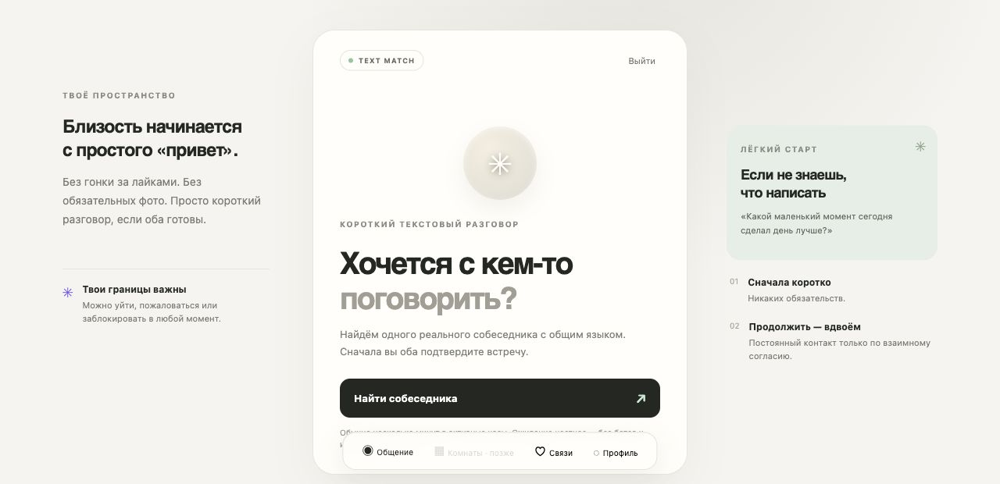
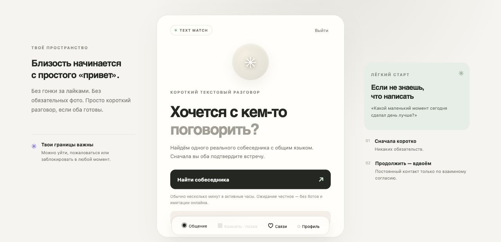
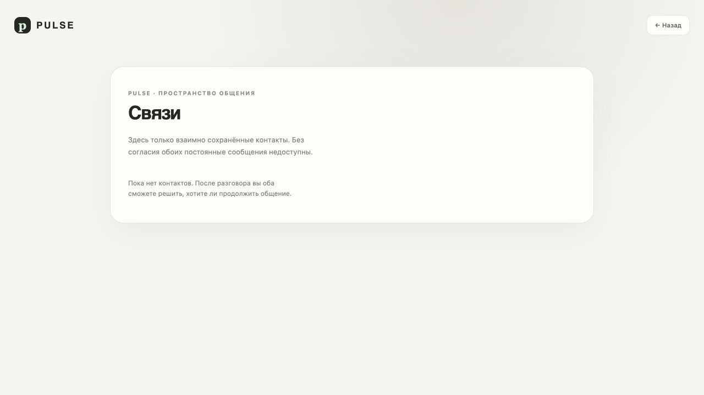

# PULSE — UX v0.4

**25.10.2026.** Проект опыта; новые экраны ещё не реализованы. Правила — [GAME_DESIGN](../GAME_DESIGN.md).

## Исходные наблюдения, не результаты новой игры

В прежней alpha наблюдались главный экран, ошибка поиска из-за Redis и пустой Connections. Полный матч не пройден; это ограниченный desktop snapshot на SHA 2c37fb9. Снимки сохранены без идентичности dev-пользователя.

Следствие: v0.4 нужны честные состояния ожидания/ошибок и реальная первая игра. Из этих снимков нельзя вывести предпочтения будущих игроков.

## Навигация

Три раздела: **Играть / Свои / Профиль**. На главной одно доминирующее действие «Играть», рядом «Пригласить друга». После допуска конкретное лобби, без длинной анкеты. Профиль — псевдоним/аватар/приватность/доступность. «Свои» — взаимные знакомые и, после G3, добровольные круги.

G1 не показывает неработающие вкладки голоса, магазинов и ленты. Для stranger-подбора честно указаны доступность и ближайшее окно. При отсутствии игроков можно пригласить друга или посмотреть **помеченный учебный пример**, не «поговорить с человеком», которого нет.

## Путь и эмоции — сценарная гипотеза

| Время | Что видно / действие | Эмоция / риск ухода | Как помочь и зачем вернуться |
|---|---|---|---|
| 0 секунд | Одно обещание и «Играть» | Интерес; неясно, игра или dating | Пример живого игрового правила, без обязательства флирта |
| 30 секунд | Допуск/псевдоним или готовое лобби вернувшегося | Новичок может ещё проходить проверку | Честные шаги; не обещать гарантированный старт за 30 секунд |
| 2 минуты | Первый выбор и прогноз, если пара готова | Неловкость/путаница | Две короткие фазы, пример, skip, понятный pending |
| 10 минут | Общий финал и результат | Удовлетворение или усталость | «Ещё» / «На сегодня всё» одинаково доступны |
| 30 минут | Новая партия либо приложение закрыто | Можно устать от однообразия | Естественный конец, без обязательных 30 минут использования |
| Следующий день | Согласованное приглашение / новое игровое окно | Нет времени, неприятен spam | Одно opt-in уведомление; никакого «он скучает» |
| Первая неделя | Узнаваемые люди и новые раунды | Новизна прошла | Хороший контент и простой повтор, не streak |
| Первый месяц | Своя небольшая компания, если возникла | Группа может уйти в мессенджер | Удобство игры/организации должно оправдывать возвращение |

## Экран раунда

Верх: фактические участники и статус соединения. Центр: карточка/варианты, текущая фаза, понятный таймер. Нижняя часть: ограниченный текст/реакции; «Пропустить» и выход всегда доступны. Собственный ответ не меняется после lock; чужой не загружается заранее в скрытый DOM.

Разделять «ответ принят сервером» и «отправляем». Результат не раскрывается преждевременно ради анимации. При reconnect показать восстановление, а не пустую новую игру. Голос позже отдельным opt-in с видимым mute и текстовой альтернативой.

## Два визуальных направления

**A — «Живая гостиная»:** тёплая светлая основа, глубокий тёмный режим, контрастный коралловый акцент, мягкие оригинальные аватары, крупная карточка. Короткое выразительное reveal, спокойный фон. Выбираем A: подходит юмору, взрослой аудитории и длинной жизни бренда.

**B — «Неоновая аркада»:** яркие спектральные эффекты, энергичное колесо, крупные игровые счётчики. Может помочь отдельной вечерней теме, но создаёт риск казино/донатного шоу и визуальной усталости. Не основа G1.

Палитра/типографика окончательно выбираются при отдельном визуальном прототипе, не выдаются за готовый дизайн.

## Критерии качества

Клавиатура/reader, focus management, достаточный контраст, крупные touch targets, reduced motion и отсутствие flashing. Таймер не единственный источник информации; тексты не кодируются только цветом. Слабый Android/реальная сеть проверяются физически, не desktop resize.

Предварительные инженерные бюджеты: стартовый JS gzip ≤250 KB, lazy второстепенные эффекты, без видео/3D в загрузке; LCP ≤2,5s на выбранном измеряемом тестовом профиле. Это цели, не уже достигнутые показатели. Проверить батарею/память и длительную сессию отдельно.
